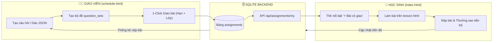

# PHƯƠNG ÁN ĐỀ XUẤT NÂNG CẤP DỰ ÁN MATH5 (VƯỜN TOÁN LỚP 3)
## TỐI ƯU HÓA QUY TRÌNH GIAO BÀI VÀ HỌC TẬP BỔ TRỢ TRÊN LỚP

> **Dự án:** Vườn Toán Lớp 3 (`Math5`) — Trường Tiểu học Hoàng Mai  
> **Nguồn đối chiếu & Đánh giá:**  
> 1. Mã nguồn thực tế tại `D:\Antigravity\Math5`  
> 2. Báo cáo đánh giá `D:\Antigravity\hoang-mai-math\docs\review\REVIEW_MATH5_VUON_TOAN_3.md` (25/10/2026)  
> 3. Báo cáo khảo sát 5 trang `D:\Antigravity\hoang-mai-math\docs\review\REVIEW_VUON_TOAN_3_PAGES_2026-10-25.md`  
> 4. Định hướng sư phạm: Thông tư 27/2020/TT-BGDĐT và Luật Bảo vệ dữ liệu trẻ em  
> **Ngày lập:** 29/10/2026 | **Người lập:** Antigravity AI  

---

## 1. TỔNG QUAN HIỆN TRẠNG & CĂN CỨ ĐỐI CHIẾU

### 1.1. Hiện trạng mã nguồn Math5
- **Công nghệ (Tech Stack):** Node.js + Express 4, SQLite (`better-sqlite3` chạy chế độ WAL), Tailwind CSS tĩnh, Vanilla JavaScript module hóa theo trang.
- **Trải nghiệm người dùng:** Giao diện sinh động, mang phong cách xúc giác 3D tactile pop (`shadow-[0_4px_0_0_#...]`), màu sắc tươi sáng phù hợp tâm lý học sinh lớp 3 (Chủ đề 2: Bảng nhân 6–9, Bảng chia 6–9).
- **Bộ 4 Mini-games toán học:** Đã hoàn thiện logic và lưu điểm vào cơ sở dữ liệu:
  - Game 1: Bắn bóng toán học (Bảng nhân 6–9)
  - Game 2: Đua xe toán học (Cổng kết quả đúng)
  - Game 3: Lật thẻ trí nhớ (Ghép cặp phép tính $\leftrightarrow$ kết quả)
  - Game 4: Câu cá thông minh (Bảng chia)
- **Hệ thống dữ liệu:** Toàn bộ lưu trữ tập trung trong 1 file SQLite duy nhất `data/vuon-toan.db`, sao lưu và di chuyển cực kỳ dễ dàng.

### 1.2. Đánh giá đối chiếu từ tài liệu Review (`hoang-mai-math/docs/review`)

| Tiêu chí | Điểm sáng từ Math5 | Hạn chế ghi nhận trong Review | Định hướng giải pháp cho Math5 |
|---|---|---|---|
| **Cơ chế thưởng Sao** | Thuật toán `starsEarned = Math.max(0, percent - oldBest)`: Sao chỉ thưởng trên phần điểm vượt kỷ lục cũ của chính mình. | Cực kỳ xuất sắc, hoàn toàn khớp với triết lý Thông tư 27 (tiến bộ so với chính mình, chống cày sao lặp lại). | **Giữ nguyên 100% thuật toán này** cho mọi bài luyện tập và bài kiểm tra. |
| **Quy trình Giao bài** | Đã có CRUD bài học và câu hỏi trong `schedule.html`. | Chưa có thực thể **Bài được giao (Assignment)**; học sinh không biết hôm nay cô giao bài nào, phải tự tìm trong mục lục. | **Bổ sung bảng `assignments` và thẻ bài giao nổi bật ngay trang chủ.** |
| **Bảo vệ quyền riêng tư & TT27** | Bảng xếp hạng điểm số công khai (`leaderboard.html`) có hiển thị top thứ hạng 1, 2, 3... | Gây áp lực tâm lý so sánh giữa các em, chưa đúng chuẩn TT27 về việc không xếp hạng công khai học sinh tiểu học. | **Chuyển hóa bảng xếp hạng thành "Góc Vinh Danh Sao Chăm Chỉ & Tiến Bộ"**; tôn vinh sự chuyên cần thay vì ganh đua điểm số. |
| **Hiệu năng & Tài nguyên** | Chạy Express + SQLite cực nhẹ, không phụ thuộc internet mạnh hay cloud đắt đỏ. | Phù hợp tuyệt đối với hạ tầng phòng máy tính hoặc máy chủ cục bộ tại các trường tiểu học. | **Không cài thêm framework nặng**, duy trì giải pháp thuần Node.js + SQLite siêu nhẹ. |

---

## 2. NGUYÊN TẮC THIẾT KẾ ĐỀ XUẤT

1. **Bảo tồn trọn vẹn Giao diện & Workflow hiện có:**
   - Giữ nguyên cấu trúc các trang HTML: `index.html`, `exercise.html`, `lesson.html`, `schedule.html`, `leaderboard.html` và 4 mini-games.
   - Giữ nguyên toàn bộ bảng màu CSS Tailwind, nút bấm 3D nổi và linh vật Bạn Cú / Bạn Sóc.
2. **Tối ưu hóa thao tác người dùng (Zero Friction):**
   - **Giáo viên:** Thao tác giao bài chỉ mất **tối đa 2 lần nhấp chuột** (Chọn bộ đề $\rightarrow$ Chọn hạn nộp $\rightarrow$ Bấm Giao). Có sẵn nút dán mã JSON để nạp đề 30 câu trong 1 giây.
   - **Học sinh:** Đăng nhập xong là thấy ngay bài cô giao đập vào mắt ở đầu trang chủ, bấm 1 nút 3D to là vào làm bài ngay.
3. **Chấm điểm tất định & Bảo mật dữ liệu:**
   - Đáp án đúng tuyệt đối không gửi về trình duyệt học sinh khi làm bài.
   - 100% việc so khớp đáp án, tính % và tính sao thưởng thực hiện trên server trong cùng một SQLite Transaction nguyên tử.

---

## 3. CHI TIẾT CÁC CHỨC NĂNG NÂNG CẤP



---

### 3.1. Phía Giáo viên: Tạo câu hỏi & Giao bài tập nhanh (`schedule.html`)

#### A. Trình tạo câu hỏi đa định dạng & Nhập nhanh JSON:
- Bổ sung form tạo câu hỏi trực quan hỗ trợ 3 dạng bài toán lớp 3 cốt lõi:
  1. **Trắc nghiệm (`multiple-choice`):** Nhập đề bài, 4 đáp án A/B/C/D, chọn đáp án đúng.
  2. **Điền số (`input`):** Nhập phép tính (VD: `7 × 8 = ?`), nhập số đúng (`56`).
  3. **Điền dấu so sánh (`compare`):** Nhập hai vế (VD: `6 × 4` và `6 × 3 + 6`), chọn dấu đúng (`=`).
- **Nút "Nhập Đề Bằng JSON" (Bulk Import):**
  - Mở cửa sổ popup cho phép giáo viên dán danh sách câu hỏi dạng JSON chuẩn (ví dụ bộ đề 30 câu ôn tập tháng 10).
  - Hệ thống kiểm tra cấu trúc và nạp tự động toàn bộ 30 câu vào cơ sở dữ liệu trong 1 giây.

#### B. Chức năng "Giao bài 1-Click":
- Tại mục quản lý bộ đề, mỗi bộ đề có thêm nút nổi bật **"Giao cho lớp"**.
- Khi bấm, hiển thị form chọn nhanh:
  - *Hạn nộp:* Nút chọn nhanh [Hôm nay] | [Ngày mai] | [Cuối tuần] | [Tùy chọn ngày].
  - *Chế độ:* Luyện tập (biết đúng/sai ngay) hoặc Kiểm tra (đếm giờ, nộp bài mới chấm).
  - *Lớp áp dụng:* Mặc định "Lớp 3A" (hoặc chọn khối/lớp).
- Bấm **"Xác nhận Giao bài"** $\rightarrow$ Hệ thống ghi vào bảng `assignments` và lập tức hiển thị cho toàn bộ học sinh trong lớp.

#### C. Bảng theo dõi tiến độ nộp bài của lớp:
- Hiển thị danh sách các bài đang giao:
  - Tên bài, ngày giao, hạn nộp.
  - Thanh tiến độ nộp bài trực quan: ví dụ `31/35 em đã hoàn thành (88%)`.
  - Nút xem chi tiết danh sách em đã nộp kèm điểm số, nút Đóng bài giao khi hết hạn.

---

### 3.2. Phía Học sinh: Nhận diện & Làm bài cô giao (`index.html` $\rightarrow$ `lesson.html`)

#### A. Khối thẻ "⭐ Nhiệm Vụ Cô Giao" tại Trang chủ (`index.html`):
- Nằm ngay dưới Banner chào mừng, được thiết kế nổi bật với viền vàng hổ phách, hiệu ứng đổ bóng 3D:
  - **Tiêu đề bài:** Tên bài tập giáo viên giao (VD: *"Phiếu ôn tập tuần 7: Bảng nhân 7 và 8"*).
  - **Nhãn thời hạn:** *"Hạn nộp: Tối nay (21:00)"* hoặc *"Còn 2 ngày nữa"*.
  - **Trạng thái thực tế:**
    - *Chưa làm:* Nút 3D xanh lá kích thước lớn **"Làm bài ngay"** $\rightarrow$ bấm vào chuyển thẳng sang `lesson.html?assignmentId=...`
    - *Đang làm dở:* Nút vàng **"Làm tiếp (Đã làm 6/10 câu)"**.
    - *Đã hoàn thành:* Huy hiệu hoàn thành xanh lục kèm kết quả (VD: *"Đạt 90% • +12 ⭐ Sao vàng"*).

#### B. Trải nghiệm làm bài (`lesson.html`):
- Giữ nguyên giao diện làm bài hiện có:
  - Thanh tiến độ câu hỏi phía trên.
  - Các nút chọn đáp án 3D, bàn phím số ảo hoặc nút chọn dấu so sánh.
- Khi nộp bài:
  - Chấm điểm và hiển thị bảng kết quả sinh động kèm hiệu ứng chúc mừng.
  - Tự động lưu tiến độ vào bảng `progress` và cập nhật Sao Nỗ Lực vào tài khoản học sinh.

---

## 4. THIẾT KẾ DỮ LIỆU & API BACKEND (SQLITE)

### 4.1. Cấu trúc bảng SQLite mới: `assignments`

Thêm vào tệp [server/db.js](file:///d:/Antigravity/Math5/server/db.js):

```sql
CREATE TABLE IF NOT EXISTS assignments (
  id               TEXT PRIMARY KEY,        -- vd: 'assign-b13-t10'
  title            TEXT NOT NULL,           -- vd: 'Phiếu ôn tập tuần 7'
  set_id           TEXT NOT NULL REFERENCES question_sets(id),
  class_name       TEXT DEFAULT 'Lớp 3A',
  mode             TEXT DEFAULT 'exercise',  -- 'exercise' | 'exam'
  due_date         TEXT,                    -- 'YYYY-MM-DD'
  status           TEXT DEFAULT 'open',     -- 'open' | 'closed'
  created_at       TEXT DEFAULT (datetime('now','localtime'))
);
```

### 4.2. Các API RESTful mới trong `server/api.js`

1. **`GET /api/assignments/my`** *(Dành cho học sinh)*:
   - Trả về danh sách bài tập đang giao của lớp học sinh đó.
   - Kèm trạng thái đã nộp hay chưa, điểm số cao nhất và số sao đã nhận.
2. **`GET /api/teacher/assignments`** *(Dành cho giáo viên)*:
   - Danh sách các bài đã giao, số lượng học sinh trong lớp đã nộp bài / chưa nộp bài, điểm trung bình.
3. **`POST /api/teacher/assignments`** *(Tạo bài giao mới)*:
   - Nhận payload: `{ setId, title, dueDate, mode, className }`.
   - Lưu vào SQLite và kích hoạt bài giao.
4. **`PUT /api/teacher/assignments/:id/status`** *(Đóng/Mở lại bài giao)*:
   - Cho phép giáo viên kết thúc đợt nộp bài.
5. **`POST /api/teacher/question-sets/import-json`** *(Nạp đề hàng loạt)*:
   - Nhận mảng 10–30 câu hỏi dạng JSON chuẩn, chèn tự động vào bảng `questions`.

---

## 5. LỘ TRÌNH TRIỂN KHAI THEO TỪNG BƯỚC

| Giai đoạn | Nội dung công việc cụ thể | Tệp mã nguồn liên quan | Kết quả đầu ra |
|---|---|---|---|
| **Bước 1** | Cập nhật cấu trúc DB SQLite & Viết các API backend | `server/db.js`<br/>`server/api.js` | Có bảng `assignments`, API giao bài, nộp bài, thống kê nộp bài. |
| **Bước 2** | Nâng cấp giao diện Góc Thầy Cô (`schedule.html`) | `public/schedule.html`<br/>`public/assets/js/pages/schedule.js` | Form giao bài 1-click, popup import JSON, bảng theo dõi tiến độ cả lớp. |
| **Bước 3** | Nâng cấp giao diện Trang chủ Học sinh (`index.html`) | `public/index.html`<br/>`public/assets/js/core/app.js` | Khối thẻ "⭐ Nhiệm Vụ Cô Giao" hiển thị bài giao thật kèm nút làm bài. |
| **Bước 4** | Đồng bộ bộ làm bài `lesson.html` với bài giao | `public/lesson.html`<br/>`public/assets/js/pages/lesson.js` | Học sinh làm đúng bài cô giao, lưu kết quả gắn với `assignmentId`. |
| **Bước 5** | Nạp sẵn dữ liệu mẫu 30 câu ôn tập tháng 10 & Kiểm thử | `data/seed.json` | Giáo viên có sẵn đề chuẩn để thử nghiệm giao bài ngay trên lớp. |

---

## 6. KẾT LUẬN & KIẾN NGHỊ

Phương án đề xuất trên giải quyết triệt để bài toán:
- **Giữ nguyên 100% bản sắc giao diện đẹp mắt, thân thiện của Math5** mà không làm xáo trộn thói quen của giáo viên và học sinh.
- **Bổ sung đúng điểm nghẽn nghiệp vụ lớn nhất:** Biến Math5 từ một kho bài tập thụ động thành một **công cụ sư phạm chủ động**, nơi giáo viên giao bài nhanh chóng và học sinh được dẫn dắt làm đúng bài cần ôn luyện.
- **Tối ưu tài nguyên tối đa:** Hệ thống vẫn hoàn toàn gọn nhẹ, vận hành mượt mà với Node.js + SQLite cục bộ, không tốn chi phí hạ tầng hay AI token ngoài dự kiến.
