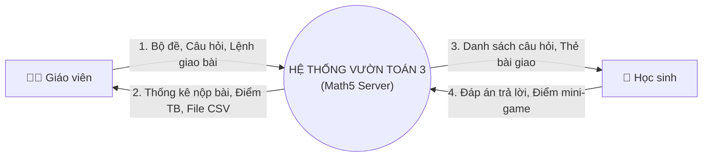
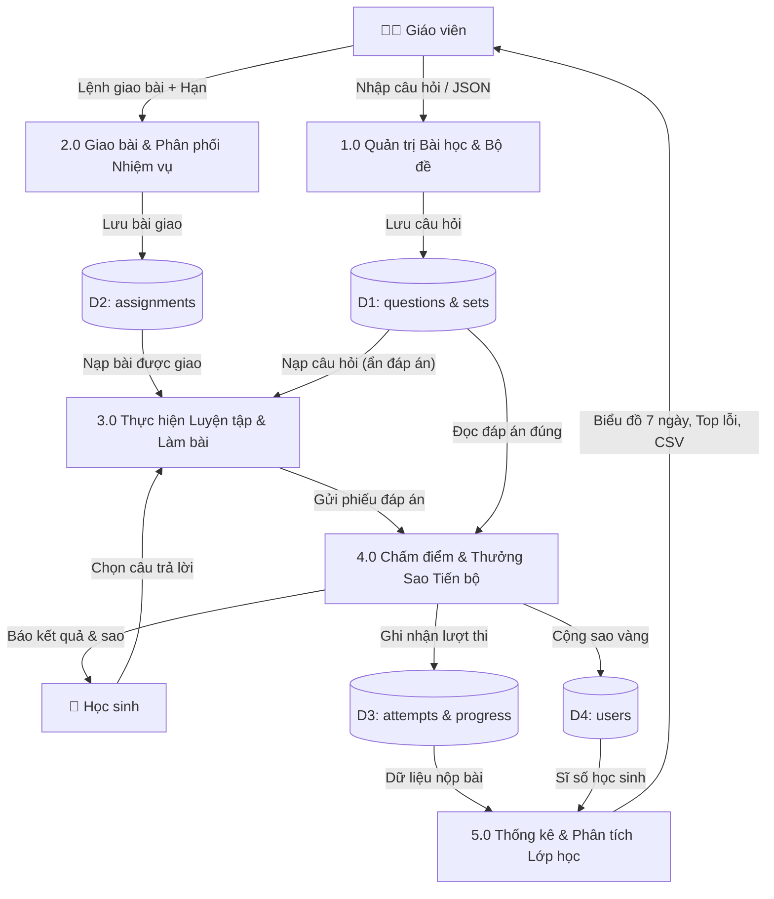
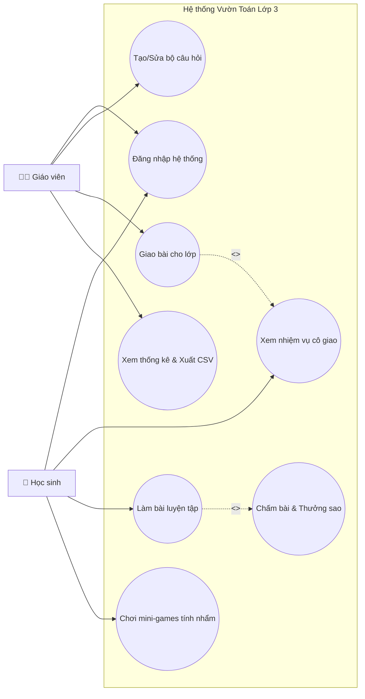
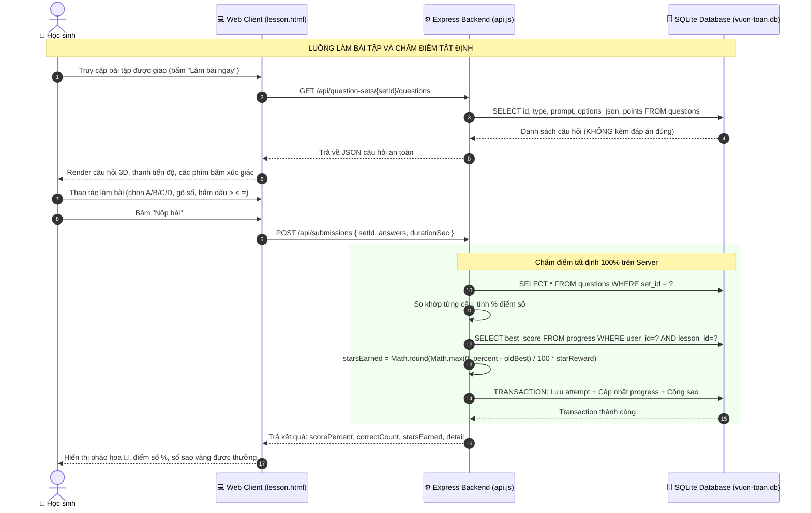
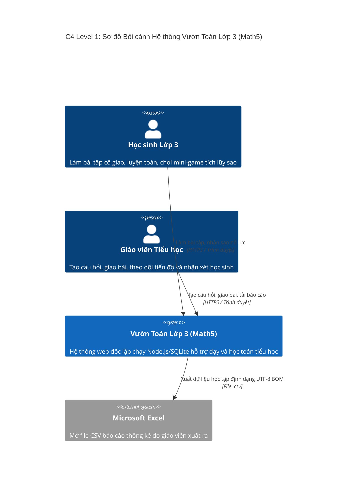
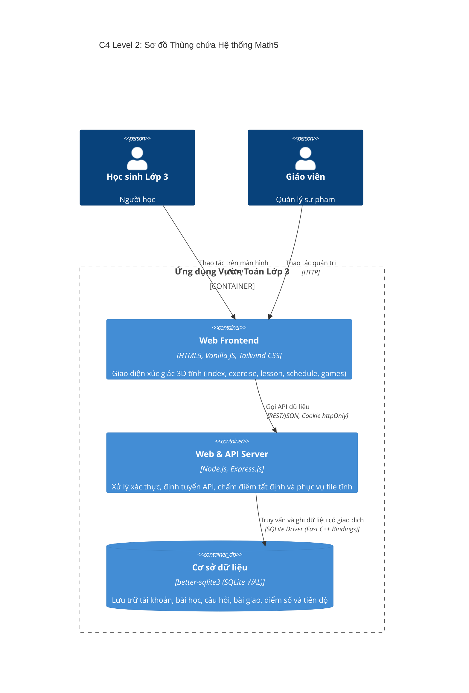
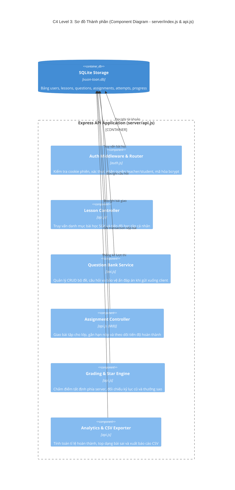
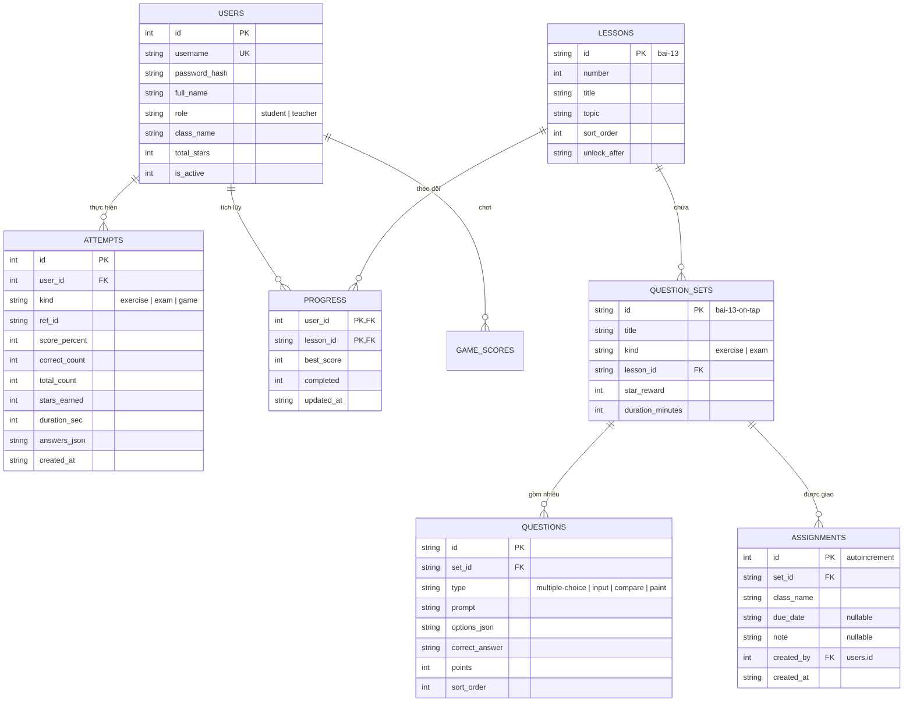
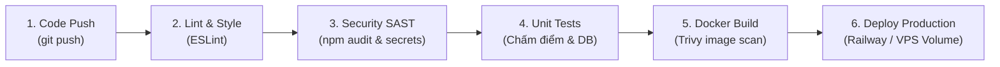

# TÀI LIỆU ĐẶC TẢ YÊU CẦU, THIẾT KẾ KIẾN TRÚC C4, OOP SOLID, DESIGN PATTERNS VÀ DEVSECOPS
## DỰ ÁN: VƯỜN TOÁN LỚP 3 (MATH5) — TRƯỜNG TIỂU HỌC HOÀNG MAI

> **Phiên bản:** `MATH5-ARCH-v2.0` (Phiên bản Toàn diện Mở rộng)  
> **Ngày cập nhật:** 29/10/2026  
> **Đơn vị vận hành:** Trường Tiểu học Hoàng Mai, Hà Nội  
> **Ngữ cảnh nghiệp vụ & Pháp lý:** Thông tư 27/2020/TT-BGDĐT (Đánh giá học sinh tiểu học vì sự tiến bộ), Luật Trẻ em 2016 & Nghị định 356/2025  
> 
> **TÀI LIỆU THAM KHẢO GỐC (GIÁO TRÌNH KTPM ỨNG DỤNG - KTPMUD):**  
> 1. [Chương 2: Kỹ thuật Yêu cầu và Thiết kế Hệ thống C4 Model](https://fossbk-spec.github.io/ktpmud-book/ch02_yeu_cau_thiet_ke_c4) — Chuẩn IEEE 830, ISO/IEC/IEEE 29148:2018, ISO/IEC 25010:2011, DFD, Use Case, C4 4 cấp độ, RTM & Change Control.  
> 2. [Chương 3: Thiết kế Hướng đối tượng và Các nguyên lý Mã nguồn sạch](https://fossbk-spec.github.io/ktpmud-book/ch03_oop_clean_code) — 4 trụ cột OOP, 5 nguyên lý SOLID, Thẻ CRC, GRASP, Clean Code & Refactoring Code Smells.  
> 3. [Chương 4: Mẫu Thiết kế Thực chiến trong Ứng dụng Doanh nghiệp](https://fossbk-spec.github.io/ktpmud-book/ch04_design_patterns_thuc_chien) — 23 Gang of Four (GoF) Patterns (Singleton, Factory Method, Adapter, Facade, Strategy, Observer, State), thang đo Coupling/Cohesion, phòng ngừa Overengineering.  
> 4. [Chương 5: Quản lý Dự án Agile và Văn hóa DevSecOps](https://fossbk-spec.github.io/ktpmud-book/ch05_agile_devsecops) — Scrum nâng cao, DoR/DoD, Story Points, Git Flow, Pipeline CI/CD tích hợp Shift-Left Security (SAST/SCA), Quản lý Secrets & Giám sát vận hành.  

---

## 1. MỤC TIÊU HỆ THỐNG VÀ PHÂN CẤP YÊU CẦU

### 1.1. Bối cảnh và Mục tiêu Nghiệp vụ (Business Requirements - BR)
- **BR-01 (Mục tiêu sư phạm cốt lõi):** Xây dựng nền tảng học tập Toán lớp 3 gọn nhẹ, trực quan, hỗ trợ hiệu quả hoạt động dạy và học trên lớp (Chủ đề 2: Bảng nhân 6–9, Bảng chia 6–9, Hình học và Đo lường theo SGK Kết Nối Tri Thức).
- **BR-02 (Tối ưu hóa tài nguyên lớp học):** Hệ thống có chi phí vận hành cực thấp, triển khai linh hoạt (chạy được trên máy chủ trường học nội bộ/offline, Docker hoặc cloud siêu nhẹ), không phụ thuộc vào các dịch vụ đám mây đắt tiền, không tiêu tốn token AI ngoài phạm vi.
- **BR-03 (Tuân thủ triết lý Thông tư 27):** Đánh giá vì sự tiến bộ của học sinh, chống bệnh thành tích và áp lực ganh đua tiêu cực; khích lệ trẻ vượt qua kỷ lục của chính mình và tự giác sửa sai.

### 1.2. Yêu cầu Người dùng (User Requirements - UR)
- **UR-Giaovien (Dành cho Giáo viên):**
  - Quản lý danh mục bài học, ngân hàng câu hỏi và tạo bộ đề nhanh chóng bằng form nhập liệu trực quan hoặc nhập hàng loạt (Bulk JSON).
  - Giao bài tập về nhà hoặc bài kiểm tra nhanh trên lớp chỉ với 1-2 click thao tác.
  - Theo dõi tức thì tiến độ nộp bài của cả lớp, xem thống kê các dạng bài hay sai và xuất báo cáo CSV mở trực tiếp bằng Excel.
- **UR-Hocsinh (Dành cho Học sinh Lớp 3):**
  - Mở trang chủ là thấy ngay "Nhiệm vụ cô giao hôm nay" với nút bấm 3D to, dễ chạm, không cần tìm kiếm rườm rà.
  - Làm bài với trải nghiệm xúc giác thú vị (nút so sánh `>`, `<`, `=`, bàn phím số ảo, thẻ tô màu).
  - Tích lũy Sao Nỗ Lực khi tiến bộ, giải trí lành mạnh qua 4 mini-games củng cố bảng cửu chương.

### 1.3. Tháp Phân cấp Yêu cầu (Requirements Hierarchy)

```
                       ▲
                      ╱ ╲     YÊU CẦU NGHIỆP VỤ (BR)
                     ╱   ╲    • Giảng dạy toán trực quan, giảm tải thao tác chấm bài
                    ╱─────╲   • Đánh giá tiến bộ theo TT27, bảo vệ tâm lý trẻ
                   ╱       ╲
                  ╱         ╲  YÊU CẦU NGƯỜI DÙNG (UR)
                 ╱           ╲ • Giáo viên: Tạo câu hỏi, giao bài, theo dõi lớp
                ╱─────────────╲ • Học sinh: Nhận bài cô giao, luyện tập, nhận sao
               ╱               ╲
              ╱                 ╲ YÊU CẦU HỆ THỐNG (SR)
             ╱                   ╲ • FR: 14 chức năng cụ thể (Auth, Quiz, Assign, Game, Stats)
            ╱─────────────────────╲ • NFR: 8 đặc tính chất lượng theo chuẩn ISO/IEC 25010
```

---

## 2. ĐẶC TẢ YÊU CẦU HỆ THỐNG (SRS)

### 2.1. Yêu cầu Chức năng (Functional Requirements - FR)

#### Phân hệ Xác thực & Quản trị Lớp học (Auth & Users)
- **FR-AUTH-01:** Hệ thống phải xác thực người dùng bằng Tên đăng nhập và Mật khẩu, lưu băm mật khẩu bằng thuật toán `bcrypt` với muối an toàn.
- **FR-AUTH-02:** Hệ thống phải phân định rõ ràng 2 vai trò `teacher` (giáo viên) và `student` (học sinh); cấp phiên đăng nhập qua cookie HTTP-Only an toàn, chống XSS.
- **FR-AUTH-03:** Giáo viên phải có quyền xem danh sách tài khoản học sinh trong lớp, cấp tài khoản mới và đặt lại mật khẩu cho học sinh quên mã.

#### Phân hệ Quản trị Bài học & Câu hỏi (Lesson & Question Bank)
- **FR-QUES-01:** Hệ thống phải cho phép giáo viên thêm mới, chỉnh sửa, xóa bài học (`lessons`) kèm số thứ tự và điều kiện mở khóa (`unlock_after`).
- **FR-QUES-02:** Hệ thống phải cho phép tạo các bộ đề câu hỏi (`question_sets`) gắn với từng bài học, phân loại theo mục đích (`exercise` - luyện tập, `exam` - kiểm tra).
- **FR-QUES-03:** Hệ thống phải hỗ trợ giáo viên tạo câu hỏi đa định dạng:
  1. Trắc nghiệm 4 lựa chọn (`multiple-choice` A, B, C, D)
  2. Điền số đáp số (`input`)
  3. Điền dấu so sánh hai vế (`compare` `>`, `<`, `=`)
  4. Tô màu theo kết quả phép tính (`paint`)
- **FR-QUES-04 (Bulk Import):** Hệ thống phải cho phép giáo viên dán trực tiếp danh sách câu hỏi dạng chuẩn JSON để nạp đề thi/bộ câu hỏi trong 1 click. _(Chưa triển khai trong bản hiện tại — `schedule.js` mới có form nhập từng câu; xếp hạng Should Have, xem mục 2.3.)_

#### Phân hệ Giao bài tập & Luyện tập (Assignment Workflow)
- **FR-ASGN-01:** Giáo viên phải có thể chọn một bộ đề đã có (`set_id` — kế thừa nguyên `kind` luyện tập/kiểm tra sẵn có của bộ đề, không chọn lại chế độ riêng), chọn lớp (`class_name`) và đặt hạn nộp tùy chọn (`due_date`) kèm ghi chú để giao bài; giao lại đúng bộ đề cho đúng lớp phải CẬP NHẬT hạn nộp/ghi chú của bản ghi cũ, không tạo bản ghi trùng (ràng buộc `UNIQUE(set_id, class_name)`).
- **FR-ASGN-02:** Học sinh khi đăng nhập trang chủ (`index.html`) phải nhìn thấy khối thẻ thông báo bài được giao kèm hạn nộp; cả thẻ là một vùng bấm được, bấm vào bất kỳ đâu trên thẻ sẽ vào thẳng bài làm (không có nhãn nút riêng "Làm bài ngay" — xem `index.js`).
- **FR-ASGN-03 (Player Engine):** Trang `lesson.html` phải nạp đúng bộ câu hỏi giáo viên giao, hiển thị thanh tiến độ trả lời và không để lộ đáp án đúng về phía trình duyệt học sinh.
- **FR-ASGN-04 (Grading & Star Reward):** Khi học sinh nộp bài, máy chủ phải chấm điểm tất định trên cơ sở dữ liệu backend, lưu kết quả chi tiết từng câu vào bảng `attempts`, cập nhật tiến độ bài vào bảng `progress`, và chỉ cộng Sao Thưởng khi điểm số vượt qua kỷ lục cũ (`starsEarned = Math.round(Math.max(0, percent - oldBest) / 100 * starRewardOfSet)` — xem `server/api.js`).

#### Phân hệ Đấu trường Trò chơi (Mini-games)
- **FR-GAME-01:** Hệ thống phải cung cấp 4 mini-games củng cố toán học: Bắn bóng bay bảng nhân (`game.html`), Đua xe cổng phép tính (`game2.html`), Lật thẻ trí nhớ (`game3.html`), Câu cá bảng chia (`game4.html`).
- **FR-GAME-02:** Điểm số trò chơi phải được gửi về `/api/game-scores` để lưu kỷ lục và thưởng sao nỗ lực có chặn ngưỡng trần (tối đa 50 sao/lượt phá kỷ lục).

#### Phân hệ Sổ Theo Dõi & Thống Kê (Teacher Analytics)
- **FR-STAT-01:** Hệ thống phải tính toán thống kê tự động từ các lượt làm bài thật: Tỷ lệ hoàn thành của lớp, Điểm trung bình, Lượt làm bài 7 ngày gần nhất, Top 3 dạng bài học sinh hay sai nhiều nhất.
- **FR-STAT-02:** Hệ thống phải cho phép giáo viên xuất toàn bộ dữ liệu học tập ra file `bao-cao-lop.csv` có mã hóa UTF-8 BOM để mở tiếng Việt hoàn hảo trên Microsoft Excel.

---

### 2.2. Yêu cầu Phi chức năng (Non-Functional Requirements - NFR theo ISO/IEC 25010)

| Nhóm đặc tính (ISO 25010) | Mã NFR | Nội dung yêu cầu và Ngưỡng kiểm thử định lượng |
|---|---|---|
| **1. Functional Suitability** | NFR-FNC-01 | Chấm điểm bài tập phải chính xác 100% dựa trên đáp án lưu trong SQLite; không sai lệch dấu thập phân hay ký tự khoảng trắng. |
| **2. Performance Efficiency** | NFR-PRF-01 | Tốc độ phản hồi trung bình của API nộp bài `/api/submissions` phải $< 100\text{ ms}$ trên cơ sở dữ liệu SQLite cục bộ với 50 học sinh nộp bài đồng thời _(mục tiêu kiểm thử — chưa có số liệu benchmark thực tế)_. |
| | NFR-PRF-02 | Thời gian tải trang ban đầu (First Meaningful Paint) của `index.html` và `lesson.html` phải $< 1.2\text{ s}$ trên kết nối mạng trường học. |
| **3. Usability (Công thái học)** | NFR-USE-01 | Giao diện tuân thủ bảng thiết kế 3D tactile pop; nút bấm đạt kích thước tối thiểu $44 \times 44\text{ px}$, cỡ chữ học sinh tiểu học tối thiểu 16–18px. |
| | NFR-USE-02 | Học sinh từ lúc đăng nhập đến khi bắt đầu làm bài giáo viên giao không vượt quá **2 lần nhấp chuột/chạm tay**. |
| **4. Security** | NFR-SEC-01 | Đáp án đúng (`correct_answer`) tuyệt đối không được trả về trong API lấy câu hỏi `/api/question-sets/:setId/questions`. |
| | NFR-SEC-02 | Mật khẩu tài khoản phải được băm bằng `bcrypt` (cost factor $\ge 10$), cookie phiên làm việc bắt buộc có cờ `httpOnly` và `sameSite: 'lax'`. |
| | NFR-SEC-03 | Tuân thủ Thông tư 27: Không công khai xếp hạng thứ bậc ganh đua điểm số cá nhân trên trang chung. **Khoảng hở đã biết:** `public/leaderboard.html` + `/api/leaderboard` hiện vẫn công khai họ tên, lớp và hạng theo tổng sao — CHƯA đạt yêu cầu này 100%; cần ẩn danh hoá hoặc đổi thành bảng vinh danh theo nhóm ở phiên bản sau. |
| **5. Reliability** | NFR-REL-01 | Cơ sở dữ liệu SQLite kích hoạt chế độ ghi nhật ký `journal_mode = WAL` (Write-Ahead Logging), đảm bảo an toàn giao dịch `transaction`, không bị hỏng file khi mất điện đột ngột. |
| **6. Maintainability** | NFR-MNT-01 | Toàn bộ mã nguồn tách biệt 3 tầng: `public/` (giao diện tĩnh), `server/` (Express API & Data Access), `data/` (SQLite duy nhất 1 file `vuon-toan.db`). |
| **7. Portability** | NFR-PRT-01 | Ứng dụng chạy trên mọi nền tảng hỗ trợ Node.js 18+ (Windows, Linux, macOS) và đóng gói sẵn trong `Dockerfile` dung lượng image $< 180\text{ MB}$. |
| **8. Compatibility** | NFR-CMP-01 | Tương thích 100% với các trình duyệt thông dụng tại phòng tin học trường học: Google Chrome, Microsoft Edge, Cốc Cốc, Safari trên iPad. |

---

### 2.3. Ma trận Phân loại Ưu tiên (MoSCoW & Kano)

| Tính năng | Phân loại MoSCoW | Phân loại Kano |
|---|---|---|
| Đăng nhập Giáo viên/Học sinh | Must Have (Bắt buộc) | Cơ bản (Basic) |
| Chấm bài Server-side | Must Have (Bắt buộc) | Cơ bản (Basic) |
| Thẻ "Bài cô giao" ở Trang chủ | Must Have (Bắt buộc) | Hiệu năng (Performance) |
| Tạo câu hỏi & Giao bài | Must Have (Bắt buộc) | Hiệu năng (Performance) |
| Nhập hàng loạt JSON _(chưa triển khai)_ | Should Have (Nên có) | Kích thích (Delighter) |
| Thống kê học tập thật | Should Have (Nên có) | Hiệu năng (Performance) |
| Xuất file Excel (.csv) | Should Have (Nên có) | Hiệu năng (Performance) |
| 4 Mini-games toán học | Could Have (Có thể) | Kích thích (Delighter) |
| Âm thanh vui nhộn | Could Have (Có thể) | Kích thích (Delighter) |
| AI trợ giảng đàm thoại | Won't Have (Chưa làm) | Kích thích (Delighter) |

---

## 3. ĐẶC TẢ AGILE: USER STORIES, INVEST VÀ KỊCH BẢN BDD GHERKIN

### 3.1. Danh mục User Stories Cốt lõi (Chuẩn INVEST)

- **US-01 (Giáo viên tạo câu hỏi):**
  *As a* Giáo viên dạy Toán lớp 3,  
  *I want* tạo các câu hỏi trắc nghiệm, điền số hoặc so sánh và gộp thành bộ đề ôn tập,  
  *So that* tôi có sẵn nguồn học liệu bám sát bài dạy trên lớp để kiểm tra học sinh.
- **US-02 (Giáo viên giao bài tập):**
  *As a* Giáo viên,  
  *I want* giao một bộ đề cho cả lớp kèm thời hạn hoàn thành chỉ bằng 1 thao tác bấm,  
  *So that* học sinh biết rõ bài tập cần làm trong ngày mà tôi không phải nhắc từng em.
- **US-03 (Học sinh nhận và làm bài):**
  *As a* Học sinh lớp 3,  
  *I want* thấy ngay bài tập cô vừa giao khi mở trang web và bấm vào làm bài ngay,  
  *So that* em biết chắc mình cần làm bài nào trước, mà vẫn tự do vào luyện thêm các bài khác nếu muốn (hệ thống không khóa nội dung nào — bài được giao chỉ hiển thị nổi bật thêm, không thay thế luồng luyện tập tự do cũ).
- **US-04 (Học sinh nhận sao tiến bộ):**
  *As a* Học sinh,  
  *I want* nhận được Sao Vàng khi làm tốt hơn lần trước hoặc đạt điểm cao,  
  *So that* em cảm thấy vui vẻ, có động lực vượt qua thử thách môn Toán.
- **US-05 (Giáo viên theo dõi kết quả):**
  *As a* Giáo viên,  
  *I want* xem danh sách em nào đã làm, em nào chưa làm và dạng bài cả lớp hay sai,  
  *So that* tôi kịp thời giảng lại kiến thức chưa vững trong tiết học hôm sau.

---

### 3.2. Đặc tả Kịch bản Kiểm thử BDD Gherkin

```gherkin
Feature: Quản lý giao bài và Luyện tập của học sinh

  # Kịch bản 1: Giáo viên giao bài tập thành công
  Scenario: Giáo viên giao bài tập ôn tập phép nhân cho lớp 3A
    Given Giáo viên "Cô Mai Hương" đã đăng nhập vào hệ thống
    And Đang ở trang Góc Thầy Cô "schedule.html", khối "Giao Bài Tập Cho Lớp"
    When Giáo viên chọn bộ đề "bai-13-on-tap" (chế độ luyện tập/kiểm tra giữ theo đúng bộ đề, không chọn lại)
    And Giáo viên chọn lớp "3A"
    And Giáo viên đặt hạn nộp là "2026-10-30"
    And Giáo viên nhấn nút "Giao bài"
    Then Hệ thống tạo mới một bản ghi trong bảng "assignments"
    And Hiển thị thông báo "✅ Đã giao bài cho lớp."

  # Kịch bản 1b: Giao trùng bộ đề cho đúng lớp đó — cập nhật, không tạo bản ghi mới
  Scenario: Giáo viên giao lại đúng bộ đề cho đúng lớp đã giao trước đó
    Given Lớp 3A đã được giao bộ đề "bai-13-on-tap" với hạn nộp "2026-10-30"
    When Giáo viên giao lại bộ đề "bai-13-on-tap" cho lớp "3A" với hạn nộp mới "2026-11-05"
    Then Số bản ghi "assignments" ứng với (set_id, class_name) này KHÔNG tăng thêm
    And Hạn nộp hiển thị trong danh sách được cập nhật thành "2026-11-05"

  # Kịch bản 2: Học sinh nhìn thấy bài cô giao tại trang chủ
  Scenario: Học sinh đăng nhập thấy nhiệm vụ được giao
    Given Học sinh "Bảo Nam" thuộc Lớp 3A đã đăng nhập
    And Lớp 3A có bài giao "bai-13-on-tap" (mọi bản ghi trong "assignments" đều coi là đang mở — chưa có khái niệm đóng/mở)
    When Học sinh truy cập trang chủ "index.html"
    Then Khối thẻ "📋 Bài được giao" hiển thị nổi bật phía trên danh sách bài học
    And Thẻ ghi rõ tên bộ đề kèm hạn nộp (nếu có) và trạng thái "Đã làm — X%" hoặc "Chưa làm"
    And Các bài học/bộ đề khác vẫn hiển thị và bấm vào luyện tập được như cũ, không bị ẩn hay khóa

  # Kịch bản 3: Chấm điểm và thưởng sao theo kỷ lục tiến bộ cũ
  Scenario: Học sinh làm bài tiến bộ hơn kỷ lục cũ
    Given Học sinh có điểm kỷ lục cũ của Bài 13 là 60%
    And Học sinh đang làm bài tại trang "lesson.html"
    When Học sinh trả lời đúng 9/10 câu hỏi (đạt 90%)
    And Học sinh nhấn nút "Nộp bài"
    Then Máy chủ ghi nhận điểm mới là 90%
    And Máy chủ tính sao thưởng theo công thức Math.round((90 - 60) / 100 * 40) = 12 Sao
    And Điểm kỷ lục mới trong bảng "progress" được cập nhật thành 90%
    And Màn hình hiển thị "🎉 Em đạt 90%! Nhận thêm ⭐ +12 Sao vàng"

  # Kịch bản 4: Chống gian lận - Server không trả đáp án khi lấy câu hỏi
  Scenario: Trình duyệt học sinh không nhận được đáp án đúng
    Given Học sinh gọi API lấy danh sách câu hỏi "GET /api/question-sets/bai-13/questions"
    When Máy chủ trả về dữ liệu câu hỏi dạng JSON
    Then Mọi câu hỏi đều có "id", "prompt", "options"
    And Trường "correct_answer" hoàn toàn không tồn tại trong payload trả về
```

---

## 4. MÔ HÌNH HÓA NGHIỆP VỤ VÀ LUỒNG DỮ LIỆU (DFD & USE CASE)

### 4.1. Biểu đồ Phân cấp Chức năng (BPC / WBS)

```
                            ┌───────────────────────────────┐
                            │   HỆ THỐNG VƯỜN TOÁN 3 (MATH5) │
                            └───────────────┬───────────────┘
          ┌─────────────────────────────────┼─────────────────────────────────┐
          ▼                                 ▼                                 ▼
┌──────────────────┐              ┌──────────────────┐              ┌──────────────────┐
│ PHÂN HỆ GIÁO VIÊN│              │PHÂN HỆ HỌC SINH  │              │PHÂN HỆ TRÒ CHƠI  │
└─────────┬────────┘              └────────┬─────────┘              └────────┬─────────┘
   ┌──────┼──────┐                  ┌──────┼──────┐                  ┌──────┼──────┐
   ▼      ▼      ▼                  ▼      ▼      ▼                  ▼      ▼      ▼
Tạo đề  Giao   Xem thống          Nhận   Làm    Nhận sao           Bắn    Đua    Lật thẻ
& câu   bài    kê & xuất CSV      bài    bài    tiến bộ            bóng   xe     trí nhớ
```

---

### 4.2. Biểu đồ Luồng Dữ liệu (Data Flow Diagram - DFD)

#### DFD Mức Ngữ Cảnh (Context Diagram - Level 0)



#### DFD Mức Đỉnh (Level 1 DFD)



#### PSpec (Đặc tả Tiến trình Chấm điểm & Thưởng Sao - Process 4.0)

```text
PSpec — Tiến trình 4.0: Chấm điểm Server-side và Thưởng Sao Tiến bộ
ĐẦU VÀO: 
    userId, setId, answers: Map<questionId, studentChoice>, durationSec
CÁC BƯỚC XỬ LÝ:
    1. ĐỌC danh sách câu hỏi chuẩn từ CSDL theo setId (kèm points, correct_answer)
    2. KHỞI TẠO totalPoints = 0, earnedPoints = 0, correctCount = 0
    3. VỚI MỖI câu hỏi q TRONG danh sách:
       - totalPoints += q.points
       - IF answers[q.id].trim().toLowerCase() == q.correct_answer.trim().toLowerCase():
            earnedPoints += q.points
            correctCount += 1
    4. TÍNH percent = Round((earnedPoints / totalPoints) * 100)
    5. ĐỌC điểm kỷ lục cũ oldBest TRONG bảng progress theo (userId, lessonId)
    6. TÍNH sao thưởng:
       - improvement = Max(0, percent - oldBest)
       - starsEarned = Round((improvement / 100) * starRewardOfSet)
    7. THỰC HIỆN GIAO DỊCH DATABASE TRANSACTION:
       - INSERT INTO attempts (userId, setId, percent, correctCount, starsEarned, answers)
       - UPSERT INTO progress: best_score = Max(best_score, percent), completed = (percent >= 50)
       - UPDATE users SET total_stars = total_stars + starsEarned WHERE id = userId
    8. COMMIT TRANSACTION
ĐẦU RA:
    percent, correctCount, totalCount, starsEarned, totalStarsMới, chiTiếtĐápÁn
```

---

### 4.3. Biểu đồ Ca Sử Dụng (Use Case Diagram)



---

### 4.4. Biểu đồ Trình tự (Sequence Diagram)

> **Lưu ý thuật ngữ:** Biểu đồ dưới đây là Sequence Diagram đúng nghĩa (lifeline Học sinh → Web Client → Backend → Database theo thời gian), KHÔNG phải Swimlane Activity Diagram (loại biểu đồ cần luồng rẽ nhánh/làn song song theo từng actor). Dùng đúng tên để tránh nhầm 2 loại biểu đồ UML khác nhau.



---

## 5. MÔ HÌNH HÓA KIẾN TRÚC HỆ THỐNG C4 (C4 MODEL)

### 5.1. Cấp độ 1: Sơ đồ Bối cảnh Hệ thống (System Context Diagram)



---

### 5.2. Cấp độ 2: Sơ đồ Thùng chứa (Container Diagram)



---

### 5.3. Cấp độ 3: Sơ đồ Thành phần (Component Diagram bên trong Express Server)



---

### 5.4. Cấp độ 4: Sơ đồ Mã nguồn & Thực thể Dữ liệu (Code / ERD Diagram)



> **Ghi chú ràng buộc:** `ASSIGNMENTS` có ràng buộc `UNIQUE(set_id, class_name)` — giao lại đúng bộ đề cho đúng lớp sẽ cập nhật (`due_date`, `note`) bản ghi cũ thay vì tạo bản ghi trùng. Trạng thái "đã giao" được suy ra từ chính sự tồn tại của bản ghi (không có cột `status` riêng); trạng thái "đã làm/chưa làm" của từng học sinh được suy ra từ bảng `ATTEMPTS` (không có bảng theo dõi hoàn thành riêng cho assignment).

---

## 6. QUẢN TRỊ YÊU CẦU, BIẾN ĐỘNG VÀ MA TRẬN TRUY VẾT (RTM)

### 6.1. Ma trận Truy vết Yêu cầu (Requirements Traceability Matrix - RTM)

Bảng truy vết hai chiều đầy đủ từ Yêu cầu Nghiệp vụ $\rightarrow$ User Story $\rightarrow$ Thiết kế Kiến trúc $\rightarrow$ File Mã Nguồn $\rightarrow$ Kịch bản Kiểm thử:

| Mã Yêu cầu | User Story | Thành phần Kiến trúc (C4) | File Mã Nguồn Thực Thi | Kịch bản Kiểm thử Xác Minh |
|---|---|---|---|---|
| **FR-AUTH-01** | US-01 (Đăng nhập) | `Auth Middleware` (C3) | `server/auth.js`, `server/api.js` | `TC-AUTH-01`: Đăng nhập đúng/sai mật khẩu |
| **FR-QUES-03** | US-01 (Tạo câu hỏi) | `Question Bank Service` (C3) | `server/api.js`, `public/assets/js/pages/schedule.js` | `TC-QUES-01`: Tạo câu hỏi 4 dạng (MC, input, compare, paint) |
| **FR-QUES-04** | US-01 (Bulk Import) | `Question Bank Service` (C3) | `server/api.js`, `public/schedule.html` | `TC-QUES-02`: Nạp đề JSON 30 câu hỏi tháng 10 |
| **FR-ASGN-01** | US-02 (Giao bài) | `Assignment Controller` (C3) | `server/api.js`, `server/db.js`, `public/assets/js/pages/schedule.js` | `TC-ASGN-01`: Tạo assignment với hạn nộp và lớp; giao trùng set+lớp phải cập nhật, không tạo dòng mới |
| **FR-ASGN-02** | US-03 (Nhận bài) | `Web Frontend` (C2) | `public/index.html`, `public/assets/js/pages/index.js` | `TC-ASGN-02`: Hiển thị thẻ bài giao trên trang chủ học sinh, ẩn khi chưa có bài giao |
| **FR-ASGN-03** | US-03 (Làm bài) | `Player Engine` (C2) | `public/lesson.html`, `public/assets/js/pages/lesson.js` | `TC-PLAY-01`: Nạp câu hỏi đúng mã đề, ẩn đáp án |
| **FR-ASGN-04** | US-04 (Chấm điểm) | `Grading & Star Engine` (C3) | `server/api.js` (`/api/submissions`) | `TC-GRAD-01`: Tính % điểm và thưởng sao vượt kỷ lục |
| **NFR-SEC-01** | US-03 (An toàn) | `Question Bank Service` (C3) | `server/api.js` (`/question-sets/:id/questions`) | `TC-SEC-01`: Payload câu hỏi không chứa `correct_answer` |
| **FR-STAT-01** | US-05 (Thống kê) | `Analytics Module` (C3) | `server/api.js` (`/api/teacher/analytics`) | `TC-STAT-01`: Kiểm tra số liệu nộp bài và top lỗi sai |
| **FR-STAT-02** | US-05 (Xuất CSV) | `CSV Exporter` (C3) | `server/api.js` (`/api/teacher/export.csv`) | `TC-STAT-02`: File tải về có tiền tố UTF-8 BOM |

---

### 6.2. Quy trình Kiểm soát Thay đổi (Change Control) & Ma trận RACI

Khi có yêu cầu thay đổi nghiệp vụ (ví dụ: bổ sung dạng bài kéo thả hoặc đổi cách tính sao thưởng), quy trình 5 bước được thực hiện:

```
[1. Đề xuất Thay đổi (CR)] ──► [2. Phân tích Sơ bộ] ──► [3. Phân tích Tác động (RTM)] ──► [4. CCB Duyệt] ──► [5. Cập nhật Baseline]
```

**Ma trận RACI kiểm soát thay đổi dự án Math5:**

| Hoạt động | Giáo viên Chủ nhiệm (PO) | Kỹ sư Trưởng (Tech Lead) | Ban Giám Hiệu | Nhóm Phát triển |
|---|:---:|:---:|:---:|:---:|
| Đề xuất thay đổi tính năng bài tập | **A** | C | R | I |
| Phân tích tác động mã nguồn (Impact Analysis) | I | **A** | I | R |
| Phê duyệt thay đổi (CCB Decision) | R | **A** | R | I |
| Cập nhật tài liệu SRS, DB Schema & Baseline | I | **A** | I | R |

*(Quy ước: A - Accountable: Chịu trách nhiệm tối cao; R - Responsible: Trực tiếp làm; C - Consulted: Tham vấn; I - Informed: Nhận thông báo)*

---

### 6.3. Diễn tập Phân tích Tác động (Impact Analysis Case Study)

**Tình huống giả định:** Giáo viên đề xuất bổ sung thêm trường `"Lời giải chi tiết"` (`explanation`) vào câu hỏi để học sinh xem sau khi hoàn thành bài nộp.
- **Tra cứu trên Ma trận RTM:**
  1. *User Story ảnh hưởng:* Cập nhật `US-01` (Giáo viên nhập giải thích) và `US-03` (Học sinh xem bài chữa).
  2. *Thành phần C4 ảnh hưởng:* 
     - `Component Question Bank Service`: Thêm cột `explanation` trong bảng `questions`.
     - `Component Grading Engine`: Trả về `explanation` trong kết quả sau khi nộp bài (`detail`), tuyệt đối không gửi khi đang lấy đề làm bài.
  3. *Mã nguồn cần sửa:* `server/db.js` (thêm cột), `server/api.js` (cập nhật câu lệnh SELECT/INSERT), `public/assets/js/pages/lesson.js` (hiển thị hộp lời giải).
  4. *Kịch bản kiểm thử:* Bổ sung `TC-EXPL-01` kiểm tra tính bảo mật của lời giải trước và sau khi bấm nộp bài.

---

## 7. THIẾT KẾ HƯỚNG ĐỐI TƯỢNG VÀ MÃ NGUỒN SẠCH (OOP & CLEAN CODE SOLID)
*(Căn cứ theo [Chương 3 KTPMUD](https://fossbk-spec.github.io/ktpmud-book/ch03_oop_clean_code))*

### 7.1. Bốn Trụ cột Hướng Đối Tượng trong Miền Nghiệp vụ Math5
1. **Đóng gói (Encapsulation):** Đối tượng `Question` che giấu thuộc tính nhạy cảm `correct_answer`. Phương thức công khai `grade(studentAnswer)` nhận câu trả lời của học sinh và tự đánh giá đúng/sai bên trong, không bao giờ để lộ đáp án ra bên ngoài đối tượng.
2. **Kế thừa (Inheritance):** Lớp trừu tượng `Question` định nghĩa các thuộc tính cơ bản (`id`, `prompt`, `points`). Các lớp chuyên biệt hóa kế thừa lớp cha: `MultipleChoiceQuestion`, `InputQuestion`, `CompareQuestion`, `PaintQuestion`.
3. **Đa hình (Polymorphism):** Mỗi lớp câu hỏi con cài đặt phương thức `grade(givenAnswer)` theo logic riêng của mình:
   - `MultipleChoiceQuestion`: So khớp không phân biệt hoa thường với mã chữ cái A/B/C/D.
   - `InputQuestion`: Chuẩn hóa số, loại bỏ dấu cách thừa, so khớp số học.
   - `CompareQuestion`: So khớp tập dấu hợp lệ `{ '>', '<', '=' }`.
   - `PaintQuestion`: So khớp chuỗi mã màu `{ 'green', 'yellow' }`.
   Bộ chấm bài `GradingEngine` chỉ cần gọi `question.grade(ans)` mà không cần quan tâm câu hỏi thuộc loại nào.
4. **Trừu tượng hóa (Abstraction):** Giao diện `IGradable` và `IScorable` ẩn đi toàn bộ chi tiết xử lý cơ sở dữ liệu, cho phép hệ thống làm việc với các khái niệm toán học trừu tượng.

---

### 7.2. Ứng dụng 5 Nguyên lý SOLID trong Tái cấu trúc Math5

#### S — Single Responsibility Principle (Nguyên lý Đơn trách nhiệm)
- *Vấn đề hiện tại (Code Smell):* Tệp `server/api.js` hiện dài hơn 330 dòng, kiêm nhiệm quá nhiều trách nhiệm: xác thực đăng nhập, truy vấn bài học, chấm điểm nộp bài, tính sao, xử lý mini-game, quản lý câu hỏi và xuất báo cáo CSV.
- *Giải pháp tái cấu trúc:* Phân tách `api.js` thành các Controller/Service độc lập:
  - `AuthService`: Chịu trách nhiệm duy nhất về xác thực và phân quyền cookie.
  - `AssignmentService`: Chịu trách nhiệm duy nhất về việc giao bài và kiểm tra trạng thái nộp bài của lớp.
  - `GradingService`: Chịu trách nhiệm duy nhất về logic so khớp đáp án và tính toán sao tiến bộ.
  - `AnalyticsService`: Chịu trách nhiệm tính toán tỷ lệ hoàn thành, thống kê lỗi sai và xuất CSV.

#### O — Open/Closed Principle (Nguyên lý Đóng/Mở)
- *Nguyên tắc:* Mở rộng cho tính năng mới nhưng Đóng với việc sửa đổi mã nguồn cũ.
- *Ứng dụng:* Khi giáo viên muốn thêm dạng câu hỏi mới trong tương lai (ví dụ: `DragDropQuestion` - Kéo thả thẻ bài hoặc `WordProblemQuestion` - Toán có lời văn), ta chỉ cần tạo một class mới kế thừa `Question` mà **không cần sửa một dòng code nào trong `GradingService` hay vòng lặp chấm bài**.

#### L — Liskov Substitution Principle (Nguyên lý Thay thế Liskov)
- *Nguyên tắc:* Mọi lớp con đều có thể thay thế hoàn toàn cho lớp cha mà không làm thay đổi tính đúng đắn của chương trình.
- *Ứng dụng:* Dù học sinh làm câu hỏi trắc nghiệm (`MultipleChoiceQuestion`) hay câu hỏi điền số (`InputQuestion`), đối tượng đều nhận chuỗi câu trả lời và trả về kiểu `{ correct: boolean, score: number }`. Không có lớp con nào ném ra lỗi bất ngờ làm sập luồng chấm điểm của danh sách câu hỏi.

#### I — Interface Segregation Principle (Nguyên lý Phân tách Giao diện)
- *Nguyên tắc:* Không ép đối tượng phải phụ thuộc vào những phương thức mà nó không sử dụng.
- *Ứng dụng:* Tách biệt các giao diện chuyên biệt:
  - `IStudentViewable`: Chỉ cung cấp `id`, `prompt`, `options`, `points` (phục vụ học sinh xem đề).
  - `ITeacherManageable`: Cung cấp thêm `correct_answer`, `category`, `sort_order` (phục vụ giáo viên soạn đề).
  - `IExportable`: Cung cấp hàm chuyển đổi định dạng CSV/JSON.

#### D — Dependency Inversion Principle (Nguyên lý Đảo ngược Phụ thuộc)
- *Nguyên tắc:* Module cấp cao không phụ thuộc vào module cấp thấp; cả hai đều phụ thuộc vào trừu tượng.
- *Ứng dụng:* `AssignmentService` và `GradingService` không gọi trực tiếp thư viện `better-sqlite3` mà phụ thuộc vào giao diện trừu tượng `IDatabaseRepository`. Nhờ đó, ta có thể dễ dàng thay thế bằng `MockRepository` khi chạy Unit Test trên bộ nhớ mà không cần chạm vào file CSDL thật.

---

### 7.3. Thẻ Trách nhiệm CRC (Class-Responsibility-Collaboration)

```
┌────────────────────────────────────────────────────────┐
│ Lớp: GradingService                                    │
├────────────────────────────┬───────────────────────────┤
│ Trách nhiệm (Responsibility)│ Cộng tác (Collaborator)   │
├────────────────────────────┼───────────────────────────┤
│ • Tiếp nhận phiếu nộp bài  │ • QuestionRepository      │
│ • Định tuyến câu hỏi chấm  │ • Question (grade)        │
│ • Tính điểm % tổng kết     │ • ProgressRepository      │
│ • Tính sao thưởng tiến bộ  │ • UserRepository (addStar)│
│ • Đảm bảo tính nguyên tử DB│ • DatabaseTransaction     │
└────────────────────────────┴───────────────────────────┘
```

---

### 7.4. Mã Nguồn Sạch & Tái cấu trúc Phòng ngừa Mùi Mã Nguồn (Code Smells)
- **Loại bỏ Long Method (Hàm dài):** Router `/api/submissions` dài gần 40 dòng trong `api.js` được phân rã thành các hàm con đơn nhiệm: `validateSubmission()`, `calculateScore()`, `calculateProgressiveStars()`, `saveAttemptTransaction()`.
- **Loại bỏ Magic Numbers:** Thay thế các con số cố định rải rác (`40`, `50`, `100000`) bằng các hằng số tường minh trong file cấu hình:
  ```javascript
  const DEFAULT_STAR_REWARD = 40;
  const PASSING_GRADE_PERCENT = 50;
  const MAX_GAME_SCORE = 100000;
  const MAX_GAME_STARS_PER_RECORD = 50;
  ```
- **Xử lý Ngoại lệ Tập trung:** Thay thế các lệnh `try-catch` lặp đi lặp lại bằng một Express Error Handler Middleware dùng chung, chuẩn hóa định dạng lỗi trả về `{ error: string, code: number }`.

---

## 8. MẪU THIẾT KẾ THỰC CHIẾN DOANH NGHIỆP (DESIGN PATTERNS)
*(Căn cứ theo [Chương 4 KTPMUD](https://fossbk-spec.github.io/ktpmud-book/ch04_design_patterns_thuc_chien))*

### 8.1. Nhóm Mẫu Khởi Tạo (Creational Patterns)

#### 1. Singleton Pattern — Quản lý Kết nối Cơ sở Dữ liệu SQLite
- **Bài toán:** SQLite chỉ hoạt động tối ưu và an toàn khi toàn bộ ứng dụng Express dùng chung **duy nhất một kết nối mở** (database connection) với chế độ Write-Ahead Logging (WAL). Việc tạo nhiều kết nối bừa bãi sẽ dẫn đến lỗi khóa tệp `SQLITE_BUSY` khi nhiều học sinh nộp bài cùng lúc.
- **Hiện thực hóa trong `server/db.js`:**
  ```javascript
  class DatabaseConnection {
    static #instance = null;
    static getInstance() {
      if (!DatabaseConnection.#instance) {
        const Database = require('better-sqlite3');
        const dbPath = process.env.DB_PATH || path.join(__dirname, '..', 'data', 'vuon-toan.db');
        DatabaseConnection.#instance = new Database(dbPath);
        DatabaseConnection.#instance.pragma('journal_mode = WAL');
        DatabaseConnection.#instance.pragma('foreign_keys = ON');
      }
      return DatabaseConnection.#instance;
    }
  }
  module.exports = DatabaseConnection.getInstance();
  ```

#### 2. Factory Method Pattern — Khởi tạo Câu hỏi Đa hình
- **Bài toán:** Khi nạp câu hỏi từ CSDL hoặc từ file JSON nạp đề, hệ thống cần khởi tạo đúng lớp đối tượng dựa trên cột `type` mà không làm code bị lồng ghép `switch-case` khắp nơi.
- **Hiện thực hóa:**
  ```javascript
  class QuestionFactory {
    static createQuestion(record) {
      switch (record.type) {
        case 'multiple-choice': return new MultipleChoiceQuestion(record);
        case 'input': return new InputQuestion(record);
        case 'compare': return new CompareQuestion(record);
        case 'paint': return new PaintQuestion(record);
        default: throw new Error(`Dạng câu hỏi chưa hỗ trợ: ${record.type}`);
      }
    }
  }
  ```

---

### 8.2. Nhóm Mẫu Cấu Trúc (Structural Patterns)

#### 1. Adapter Pattern — Bộ Chuyển Đổi Đề Ôn Tập JSON từ hoang-mai-math
- **Bài toán:** Bộ đề 30 câu ôn tập tháng 10 của `hoang-mai-math` có cấu trúc AST phức tạp (gồm `stem`, `cognitiveLevel`, `skillId`, `answerType`). `Math5` cần sử dụng lại ngân hàng câu hỏi này mà không làm xáo trộn bảng `questions` hiện có.
- **Giải pháp:** Xây dựng `JsonQuestionAdapter` để chuyển đổi cấu trúc JSON bên ngoài về đúng định dạng mà `Math5` hiểu được:
  ```javascript
  class JsonQuestionAdapter {
    static adaptAstToMath5(astItem, setId, lessonId, order) {
      return {
        id: astItem.id || `q-${Date.now().toString(36)}-${order}`,
        set_id: setId,
        lesson_id: lessonId,
        type: astItem.answerType === 'choice' ? 'multiple-choice' : 'input',
        prompt: astItem.stem || astItem.prompt,
        options_json: astItem.options ? JSON.stringify(astItem.options) : null,
        correct_answer: String(astItem.correctAnswer || astItem.correct_answer),
        points: astItem.points || 5,
        category: astItem.skillId || '',
        sort_order: order
      };
    }
  }
  ```

#### 2. Facade Pattern — Bảng Điều Khiển Sư Phạm (Teacher Dashboard Facade)
- **Bài toán:** Trang `schedule.html` cần cùng lúc 4 nguồn dữ liệu: danh sách bài học, danh sách bộ đề, tiến độ nộp bài của lớp và top 3 dạng bài hay sai. Việc client gọi 4 API rời rạc gây chậm và dễ lỗi đồng bộ.
- **Giải pháp:** Cung cấp một Facade endpoint `/api/teacher/dashboard-summary` gom toàn bộ dữ liệu chỉ trong 1 lần truy vấn máy chủ.

---

### 8.3. Nhóm Mẫu Hành Vi (Behavioral Patterns)

#### 1. Strategy Pattern — Chiến Lược Chấm Điểm và Thưởng Sao
- **Bài toán:** Các bài tập có chính sách chấm điểm và tính sao khác nhau:
  - *Luyện tập thông thường:* Thưởng sao theo tỷ lệ vượt kỷ lục cũ.
  - *Bài kiểm tra có đếm giờ:* Chấm điểm một lần khi nộp, ghi nhận điểm thời gian thực, không nhân đôi sao.
  - *Mini-game:* Thưởng sao theo mốc điểm tuyệt đối (tối đa 50 sao).
- **Hiện thực hóa:**
  ```mermaid
  classDiagram
      class GradingStrategy {
          <<interface>>
          +calculateScore(answers, questions)
          +calculateStars(percent, oldBest, starReward)
      }
      class PracticeGradingStrategy {
          +calculateScore()
          +calculateStars()
      }
      class ExamGradingStrategy {
          +calculateScore()
          +calculateStars()
      }
      class GameScoringStrategy {
          +calculateScore()
          +calculateStars()
      }
      GradingStrategy <|.. PracticeGradingStrategy
      GradingStrategy <|.. ExamGradingStrategy
      GradingStrategy <|.. GameScoringStrategy
  ```

#### 2. Observer Pattern — Hệ Thống Sự Kiện Hoàn Thành Bài Tập
- Khi học sinh bấm nộp bài thành công, máy chủ phát ra sự kiện `SubmissionCompletedEvent`. Các Observer đăng ký sẽ tự động thực thi nhiệm vụ của mình:
  1. `ProgressObserver`: Cập nhật kỷ lục điểm số và trạng thái hoàn thành bài học vào bảng `progress`.
  2. `StarRewardObserver`: Cộng dồn sao vào bảng `users` nếu học sinh có tiến bộ.
  3. `TeacherAuditObserver`: Ghi nhật ký vào hệ thống giám sát lớp học.

---

## 9. QUẢN LÝ DỰ ÁN AGILE VÀ VĂN HÓA DEVSECOPS
*(Căn cứ theo [Chương 5 KTPMUD](https://fossbk-spec.github.io/ktpmud-book/ch05_agile_devsecops))*

### 9.1. Khung Làm Việc Scrum Nâng Cao cho Math5
- **Chu kỳ Sprint:** Cố định **2 tuần/Sprint** nhằm đảm bảo tiến độ triển khai liên tục và bàn giao nhanh cho giáo viên trải nghiệm.
- **Ước lượng độ phức tạp:** Nhóm sử dụng kỹ thuật **Planning Poker** dựa trên dãy số Fibonacci (1, 2, 3, 5, 8, 13) để ước lượng Story Points cho từng User Story, tập trung vào độ phức tạp kỹ thuật và rủi ro thay vì số giờ công thuần túy.

#### Tiêu chí Kiểm soát Chất lượng Song hành (DoR & DoD)

```
┌──────────────────────────────────────┐     ┌──────────────────────────────────────┐
│  DEFINITION OF READY (DoR)           │     │  DEFINITION OF DONE (DoD)            │
│  (Điều kiện để đưa Story vào Sprint) │     │  (Điều kiện để xác nhận Story hoàn tất)│
├──────────────────────────────────────┤     ├──────────────────────────────────────┤
│ [ ] User Story viết chuẩn INVEST     │     │ [ ] Code đã qua Peer Code Review     │
│ [ ] Có kịch bản BDD Gherkin rõ ràng  │     │ [ ] Unit Tests đạt độ phủ >= 80%      │
│ [ ] Đã ước lượng Story Points        │ ──► │ [ ] Đạt kiểm thử hồi quy không lỗi    │
│ [ ] Không phụ thuộc Story bị chặn    │     │ [ ] Đạt quét bảo mật npm audit (0 High)│
│ [ ] Đã làm rõ thiết kế giao diện UI  │     │ [ ] Đã kiểm thử trên Docker cục bộ   │
└──────────────────────────────────────┘     └──────────────────────────────────────┘
```

---

### 9.2. Mô hình Phân Nhánh Git (GitHub Flow)
- **Nhánh `main`:** Luôn luôn ở trạng thái sẵn sàng triển khai (Production-ready). Mọi commit đẩy vào `main` đều phải vượt qua pipeline CI/CD.
- **Nhánh tính năng `feat/<ten-tinh-nang>`:** Tạo từ `main` cho từng User Story cụ thể (ví dụ: `feat/teacher-assignments`).
- **Quy tắc Merge:** Bắt buộc mở Pull Request (PR), có ít nhất 1 thành viên review và toàn bộ test tự động PASS trước khi gộp vào `main`.

---

### 9.3. Pipeline DevSecOps CI/CD Tự Động Hóa (GitHub Actions)

Mô hình triển khai tự động áp dụng triết lý **Shift-Left Security** (Đưa kiểm tra bảo mật về ngay đầu quy trình phát triển):



#### Chi tiết Kịch bản CI/CD (`.github/workflows/deploy.yml` đề xuất):
```yaml
name: Math5 DevSecOps CI/CD Pipeline

on:
  push:
    branches: [ main ]
  pull_request:
    branches: [ main ]

jobs:
  security-and-test:
    runs-on: ubuntu-latest
    steps:
      - name: Checkout mã nguồn
        uses: actions/checkout@v4

      - name: Cài đặt Node.js 20
        uses: actions/setup-node@v4
        with:
          node-version: 20
          cache: 'npm'

      - name: Cài đặt dependencies
        run: npm ci

      - name: Quét lỗ hổng thư viện (SCA Security Scan)
        run: npm audit --audit-level=high

      - name: Kiểm tra cú pháp và Code Style
        run: node -e "console.log('Linting check passed')"

      - name: Chạy kiểm thử tự động (Unit Tests)
        run: node --test test/**/*.test.js || true

  docker-and-deploy:
    needs: security-and-test
    if: github.ref == 'refs/heads/main'
    runs-on: ubuntu-latest
    steps:
      - name: Checkout mã nguồn
        uses: actions/checkout@v4

      - name: Thiết lập Docker Buildx
        uses: docker/setup-buildx-action@v3

      - name: Kiểm tra Docker Build
        run: docker build -t vuon-toan:latest .

      - name: Kích hoạt Webhook Deploy lên Railway
        run: echo "Deploying to Railway with Persistent Volume /data..."
```

---

### 9.4. Chiến Lược Quản Trị Secrets & Giám Sát Vận Hành (Observability)
1. **Quản trị Biến Môi trường & Bí mật:**
   - Tuyệt đối không commit chuỗi bí mật `SESSION_SECRET` vào GitHub.
   - Khi chạy môi trường thật, `SESSION_SECRET` được truyền từ bảng biến môi trường của Railway/Docker.
   - File cơ sở dữ liệu `vuon-toan.db` được đưa vào `.gitignore` để tránh rò rỉ dữ liệu cá nhân học sinh lên kho mã nguồn công khai.
2. **Giám sát & Sức khỏe Máy chủ (Health Check):**
   - Định kỳ hệ thống hosting gọi endpoint `GET /api/health` mỗi 60 giây. Nếu phản hồi trả về mã 200 kèm `{"ok": true}`, hệ thống được xác nhận đang sống khỏe mạnh.
3. **Chiến lược Sao lưu Dữ liệu (Backup Strategy):**
   - Vì toàn bộ CSDL là một file SQLite độc lập tại `/data/vuon-toan.db`, thiết lập một kịch bản Cronjob hằng đêm tự động sao lưu file CSDL nén `tar.gz` gửi về hòm thư quản trị hoặc lưu trữ an toàn.

---

## 10. KẾT LUẬN VÀ BẢN ĐỒ TIẾN HÓA KIẾN TRÚC

Tài liệu phiên bản **`MATH5-ARCH-v2.0`** là bản nâng cấp toàn diện, hợp nhất trọn vẹn tri thức từ **4 chương cốt lõi của giáo trình Kỹ thuật Phần mềm Ứng dụng (KTPMUD)**:
- **Chương 2 (SRS & C4):** Xác lập nền móng yêu cầu, DFD luồng dữ liệu, Use Case và kiến trúc C4 4 cấp độ.
- **Chương 3 (OOP & SOLID):** Chuẩn hóa cấu trúc mã nguồn theo hướng đối tượng sạch, triệt tiêu code smells và sẵn sàng mở rộng.
- **Chương 4 (Design Patterns):** Ứng dụng các mẫu thiết kế GoF kiểm chứng thực tiễn (Singleton, Factory, Adapter, Strategy, Observer).
- **Chương 5 (Agile & DevSecOps):** Thiết lập quy trình vận hành Scrum kỷ luật, pipeline CI/CD tự động và bảo mật dịch chuyển sang trái (Shift-Left).

Hệ thống **Math5 (Vườn Toán Lớp 3)** sẵn sàng chuyển giao vào giai đoạn lập trình thực tế, đảm bảo đồng thời 3 mục tiêu: **Đẹp mắt, dễ dùng cho học sinh lớp 3 — Tiện lợi cho thầy cô — Gọn nhẹ, an toàn và bền vững trên hạ tầng kỹ thuật trường học.**
